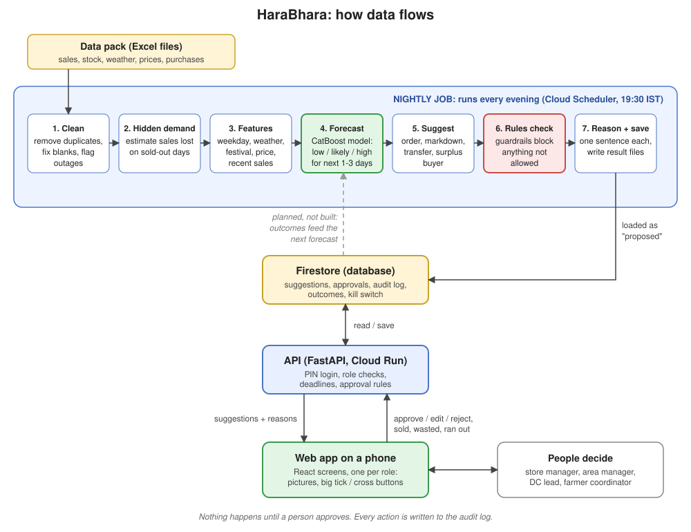

# Architecture: HaraBhara Fresh decision tool

What the code does today, as read from the repo on 2026-11-15. [CLAUDE.md](CLAUDE.md) is the design
spec and several of its planned file names differ from what exists (see "Spec vs code").
Items marked *(unverified)* come from reading code without running it.

## 1. What it is

Decision support for a fresh-produce retailer. Each evening it suggests store orders; each
morning it flags likely leftovers (markdown, transfer, surplus buyer) and likely sell-outs
(transfer). A person approves, edits (with a reason) or rejects every suggestion. All data is
synthetic and the data pack is not in the repo.

## 2. Entry points

| Entry point | File | Purpose |
|---|---|---|
| Offline pipeline | `harabhara/pipeline/run.py` (`main`, `build_outputs`) | Reads the data pack, trains, forecasts, writes JSON outputs |
| Daily job | `harabhara/jobs/daily.py` (`run_daily`) | Runs the pipeline and loads results into storage |
| API server | `harabhara/api/main.py` (`build_app`) | Production wiring: FastAPI + Firestore, also serves the built web app |
| Test server | `scripts/serve_e2e.py` | Real API on synthetic data and test PINs for browser tests |
| One-shot final test | `scripts/holdout_run.py` | Reads the holdout exactly once |
| Report scripts | `scripts/*_report.py`, `ledger_calibration.py` | Evaluate models and replay on training data only |
| OpenAPI export | `scripts/export_openapi.py` | Writes `frontend/pwa/src/api/openapi.json` |
| Web app | `frontend/pwa` (Vite) | React role-based screens |

## 3. Data flow



Text version of the same flow:

```
Excel data pack (sales, external factors, procurement)
  -> pipeline/inputs.py        load_pack
  -> data/clean.py             dedupe, rebuild blank waste, flag POS outages
  -> features/hidden_demand.py estimate demand lost to sold-out days
  -> features/build.py         one row per store x product x day x horizon (1-3)
  -> pipeline/forecast.py      CatBoost q10/q50/q90, conformal range shift, cold-start rule
  -> decisions/builder.py      order (newsvendor), markdown, transfer, surplus suggestions
  -> reasons/writer.py         one template sentence per suggestion (no reason = dropped)
  -> rules/engine.py           guardrail filters; blocked items kept with violations
  -> pipeline/run.py           write_outputs: JSON files
  -> jobs/daily.py + api/loader.py  load into Storage (Firestore in prod) as "proposed"
  -> api/ (FastAPI) + workflow/     role-scoped reads, approve/edit/reject, audit log
  -> frontend/pwa                   screens per role
```

Config (`config/*.yaml`, six files) is validated by strict pydantic models. Unknown playbook
values are `null`. A SHA-256 digest of the config is stamped on every forecast and suggestion.

## 4. Modules (`harabhara/`)

| Module | Job |
|---|---|
| `settings/` | Config loading and validation (`load_config`, `PlaceholderError`, `AppConfig`) |
| `data/` | Cleaning (`clean.py`), panel building, live mandi price client (`external.py`) |
| `features/` | Hidden-demand estimate, point-in-time feature assembly |
| `models/` | `DemandModel` (3 CatBoost quantiles), conformal calibration, cold start, `ShelfLifeModel` (clamped to playbook cap), baselines |
| `state/projection.py` | Stock-by-age projection under low/likely/high demand (plays the "ledger" role) |
| `decisions/` | Economics, order rule, markdown, transfer, surplus, allocation (simulator only), suggestion builder |
| `rules/` | `RulesEngine` and one `check_*` function per guardrail |
| `reasons/` | Template-based reason writer |
| `workflow/` | Approval state machine, deadlines (Asia/Kolkata), audit event builders, stale-data fallback |
| `api/` | FastAPI app, `Service`, PIN auth with signed tokens, Storage protocol (in-memory, Firestore) |
| `sim/` | Stock-ledger simulator, three-scenario replay, metrics, scorecards |
| `assistant/` | LLM Q&A over one stored suggestion (not wired in, see risks) |
| `pipeline/`, `jobs/` | Orchestration |

## 5. Approval workflow and API

- States: `proposed` -> `approved` / `edited` / `rejected` / `expired`; `approved`/`edited` -> `done`
  when a closing outcome is recorded. Edits need units and a reason.
- Roles: `store_manager`, `area_manager` (optionally area-scoped), `dc_lead`, `farmer_coordinator`.
- Auth: `POST /auth/login` with a PIN returns a 12-hour HMAC token. 5 failed logins per 60 s per client.
- Endpoints under `/api/v1`: forecasts, suggestions (+ decision), projections, dc/totals,
  dc/orders, prices, farmers/forecast, scorecard (+ recorded), contacts, outcomes,
  assistant/ask, audit, admin/kill-switch, plus public `/health`.
- Audit is append-only with deterministic ids. Writes use compare-and-set. The kill switch
  fails safe (a failed read counts as on).
- Expiry runs lazily on reads, with no scheduler.

## 6. Frontend (`frontend/pwa`)

React 19 + TypeScript + Vite. No router; `App.tsx` switches on role. Store manager has Evening,
Morning, Surplus and Closing tabs; area manager has gauges, approvals and the kill switch; DC lead
has per-product rollups and prices; farmer coordinator has an estimate sheet. Types are generated
from the backend OpenAPI file. `VITE_MOCK_API=1` runs it without a backend.

## 7. Infra and CI

- Terraform (GCP, `asia-south1`): one Cloud Run service (public invoker), Firestore, Secret
  Manager, Artifact Registry, GitHub-to-GCP auth limited to this repo's `main`. Optional daily
  Cloud Run job + Scheduler (19:30 IST), off by default. State is local.
- Dockerfile: two-stage Python 3.12 + uv, non-root.
- `ci.yml`: ruff, mypy, pytest + web lint/typecheck/Vitest/build. `deploy.yml`: on push to
  `main`, re-runs Python checks only, then deploys.

## 8. Tests

`tests/rules` (one file per guardrail, Hypothesis property tests on farmer floor, confirmed
volume, grade C, limits, reason writer), `tests/model`, `tests/backend` (fake Firestore),
`tests/scenarios` (T02, T04, T07-T09), `test_traceability.py` (every non-planned row in
`docs/traceability.yaml` must have code and test on disk). Frontend tests live in
`frontend/pwa` (Vitest, Playwright), not `tests/frontend`. Suite was not run for this document.

## 9. Status

- Traceability: 42 rows; 32 implemented, 4 verified (G11, T01, T03, T10), 6 planned
  (PB04, PB05, PB06, PB11, PB18, T05).
- Deferred (ADR-0005 / handover): LightGBM challenger, robustness runs, weekly retrain and model
  registry, voice, translations, offline mode, usability test, shadow mode and pilot, learning
  from recorded outcomes, a real daily feed.
- Holdout: WAPE 19.5% vs managers' 23.6%; range coverage 82.2%; waste 5.76% vs the brief's 5.5%.

## 10. Spec vs code

- No `data/validate.py`, `features/weather|calendar|price.py`, `state/stock_ledger.py`,
  `models/registry.py` or `decisions/farmer_volumes.py`. Their work is folded into `clean.py`,
  `features/build.py` and `state/projection.py`. ADR-0003 explains the single-package layout.
- Database: spec says Postgres; ADR-0005 chose Firestore. ADR-0002 is still "Proposed".
- No true per-lot ledger. Lot ages are inferred from deliveries during replay warm-up.
- Frontend deferrals (voice, languages, offline, photos) are listed in section 9.

## 11. Gaps and risks

Verified by grep:
- **G02, G03 check functions are only called from tests** (`check_purchase_price`,
  `check_spot_trim`). `check_scorecard` has no callers at all. The engine does call the grade C,
  recall, kill-switch and other checks.
- **`PlaceholderError` is never raised in app code.** `require()` is only exported, so a `null`
  config value (e.g. the lost-sale basket allowance) can flow through as `None`.
- **`harabhara.assistant` is not imported outside itself.** The app uses its own `AssistantPort`
  and defaults to `NotConfiguredAssistant`. "LLM may only reword" is a prompt rule only.
- **`MandiPriceClient` and `price_shock` code are not referenced** outside config schema.

Reported by agents, not independently verified:
- `Facts.recalled`, `Facts.lot_grade` and `Facts.kill_switch` are never populated by the builder,
  so G05/G08 may not fire in the live path. The kill switch is enforced in `api/loader.py` only.
- `SURPLUS_GRADE = "B"` is hard-coded in `builder.py`.
- Farmer-share scorecard is computed although `farmer_share` is `null` in `metrics.yaml`.
- `modeling.yaml` has inconsistent dates (`fit_until`, `training_period_end`); the pipeline uses
  the as-of day minus 1.
- One bad row makes `clean_sales` raise and aborts the whole run.
- `decide` moves state before writing the approval; a failed second write leaves them out of sync.
- Login rate limit is per process, so it is weak across Cloud Run instances. Tokens are in
  `sessionStorage`, are not revocable, and no CSP headers were found. The service is public.
- A plain `terraform apply` without `mount_secrets` / `daily_job_enabled` can strip secrets and
  the daily job. Deploy does not run web tests.
- Docs are stale in places (plan.md status board, handover vs daily-job doc on whether the job is
  on, `docs/api.md` missing four endpoints). T05 (price shock) has no test.
- The daily job is a demo: it cycles 28 past days and shifts dates to today.
- `work/` is a dangling symlink to a path on another machine, so the data pack is unavailable here.
